<div align="center">

# ev-diffusion — EV Adoption Diffusion And Review Sentiment

**ev-diffusion is a forecasting and text-analysis toolkit for electric-vehicle (EV) adoption studies. It takes registration counts and owner reviews through these steps to a tested forecast and evidence-backed review findings:**

`audit coverage` → `build the series` → `fit Bass and GBM` → `backtest against baselines` → `bootstrap the forecast` → `cross-validate sentiment` → `tag aspects`.


**[Summary](#1-summary)** ·
**[Workflow](#4-the-end-to-end-workflow)** ·
**[Run it](#10-how-to-run-ev-diffusion)** ·
**[Configuration](#104-environment-variables)** ·
**[Known problems](#13-known-problems)** ·
**[Glossary](#15-glossary)**

</div>

> [!NOTE]
> This README uses ASD-STE100 Simplified Technical English. The writing rules and the project
> vocabulary are in [`docs/ste-style-guide.md`](docs/ste-style-guide.md). Each term in the
> [Glossary](#15-glossary) has only one meaning.

---

ev-diffusion forecasts the yearly adoption of electric vehicles with the Bass model and the Generalized Bass Model (GBM). It also measures the sentiment of owner reviews. The main idea is that every number has a check behind it. A forecast must beat simple baselines in a rolling-origin backtest. An interval comes from the residuals of the data. A claim about a review topic must cite a count and a Wilson interval.

This README is the **one location that explains all of ev-diffusion**. It gives these topics:

- the general design
- each component and its procedure, step by step
- the decision rules
- the data map
- the runbook
- the validation results and the known problems

| If you are… | Read |
|---|---|
| A manager or reviewer | [1](#1-summary), [3](#3-design-rules), [4](#4-the-end-to-end-workflow), [12](#12-validation-results), [14](#14-key-points) |
| A developer who joins the project | All sections, in sequence. Keep [10](#10-how-to-run-ev-diffusion) and [13](#13-known-problems) open while you work |
| An analyst who runs ev-diffusion | [10](#10-how-to-run-ev-diffusion), then the section for the component that you use |

---

## Table of contents

1. 🧭 [Summary](#1-summary)
2. 🏗️ [How ev-diffusion is built](#2-how-ev-diffusion-is-built)
   - 2.1 [Components](#21-components)
   - 2.2 [System context](#22-system-context)
   - 2.3 [Repository layout](#23-repository-layout)
3. 🛡️ [Design rules](#3-design-rules)
4. 🔄 [The end-to-end workflow](#4-the-end-to-end-workflow)
   - 4.1 [Full flow](#41-full-flow)
   - 4.2 [The life cycle of one study](#42-the-life-cycle-of-one-study)
   - 4.3 [Who does which step](#43-who-does-which-step)
5. 🔵 [Registration data and the coverage audit](#5-registration-data-and-the-coverage-audit)
6. 🟢 [Diffusion models, backtest and bootstrap](#6-diffusion-models-backtest-and-bootstrap)
7. 🟣 [Review sentiment and aspects](#7-review-sentiment-and-aspects)
8. ⚖️ [Decision rules and thresholds](#8-decision-rules-and-thresholds)
9. 🗂️ [Data and file map](#9-data-and-file-map)
10. ▶️ [How to run ev-diffusion](#10-how-to-run-ev-diffusion)
    - 10.1 [Prerequisites](#101-prerequisites) · 10.2 [Installation](#102-installation) · 10.3 [Run ev-diffusion](#103-run-ev-diffusion) · 10.4 [Environment variables](#104-environment-variables)
11. 🧩 [How to extend ev-diffusion](#11-how-to-extend-ev-diffusion)
12. ✅ [Validation results](#12-validation-results)
13. ⚠️ [Known problems](#13-known-problems)
14. 📌 [Key points](#14-key-points)
15. 📖 [Glossary](#15-glossary)
16. 📄 [License](#16-license)

---

## 1. Summary

**The problem.** A diffusion forecast of EV adoption is easy to draw and hard to trust. These are the difficult questions:

- Does the growth in the data come from adoption, or from new states that join the registration file?
- Does the forecast beat a naive rule on years that the fit did not see?
- How wide is the uncertainty, if the interval must come from the data?
- Do covariates such as charging ports change the diffusion speed, and can the data identify that effect?
- Which review topics are real concerns, and how strong is the evidence?

ev-diffusion gives each of these questions its own component. Each component writes its result as a table, so a reviewer can check every number.

| Item | Value |
|---|---|
| Input | A registration file (year, count, optional state and model), an optional covariate file, a review file (text, rating) |
| Output | A coverage table, Bass and GBM fits with HAC standard errors, a backtest table, a forecast with bootstrap intervals, sentiment scores, an aspect table, `report.md` and `report.json` |
| Components | **7**: data loaders, coverage audit, diffusion models, backtest, bootstrap, sentiment models, aspect tagger |
| Providers | None required. An optional transformer encoder (Hugging Face) is available in the `transformer` extra |
| Offline mode | Everything. `ev-diffusion demo` writes synthetic data and runs the full study with no download, no key and no network |
| Safety | National rows and state rows are never added together. A model never sees a year at or after its backtest origin |
| Tests | **86** unit tests (`pytest`), 0 skipped |

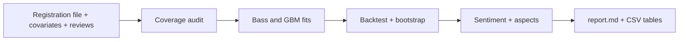

---

## 2. How ev-diffusion is built

### 2.1 Components

| Component | Module | Purpose |
|---|---|---|
| Settings | `src/ev_diffusion/config.py` | Read the environment variables |
| Column contracts | `src/ev_diffusion/schema.py` | Map header aliases, check types, stop on bad rows |
| Registration loader and audit | `src/ev_diffusion/data/registrations.py` | Coverage table, partial-year rule, national or balanced series |
| Covariate loader | `src/ev_diffusion/data/covariates.py` | Log changes of positive covariates for the GBM |
| Review loader | `src/ev_diffusion/data/reviews.py` | Rating-to-label map, unrated reviews, duplicates |
| Synthetic data | `src/ev_diffusion/data/synthetic.py` | Generated registrations, covariates and reviews |
| Bass model | `src/ev_diffusion/diffusion/bass.py` | Curve functions, multi-start least-squares fit, identification notes |
| GBM | `src/ev_diffusion/diffusion/gbm.py` | Covariate clock, identification checks, F test against Bass |
| Inference | `src/ev_diffusion/diffusion/inference.py` | OLS and HAC covariance, Ljung-Box, Durbin-Watson, AIC, AICc, BIC |
| Baselines | `src/ev_diffusion/diffusion/baselines.py` | Naive, drift, exponential, logistic, Bass and GBM forecasters |
| Bootstrap | `src/ev_diffusion/diffusion/uncertainty.py` | Moving-block residual bootstrap and intervals |
| Backtest | `src/ev_diffusion/backtest.py` | Rolling-origin errors per model and horizon |
| Text preparation | `src/ev_diffusion/sentiment/preprocess.py` | Tokens, negation scope, stopwords without negations |
| Sentiment models | `src/ev_diffusion/sentiment/models.py` | Majority, logistic regression, Complement NB, linear SVM pipelines |
| Cross-validation | `src/ev_diffusion/sentiment/evaluate.py` | Repeated stratified folds, macro-F1, corrected intervals |
| Aspect tagger | `src/ev_diffusion/sentiment/aspects.py` | Aspect mentions, polarity, Wilson intervals, concern status |
| Transformer model (optional) | `src/ev_diffusion/sentiment/transformer.py` | Frozen encoder features plus logistic regression |
| Report | `src/ev_diffusion/report.py` | Full study, Markdown and JSON output |
| CLI | `src/ev_diffusion/cli.py` | The `ev-diffusion` command |

The component map shows which module calls which module. An arrow points from the caller to the module that it uses.

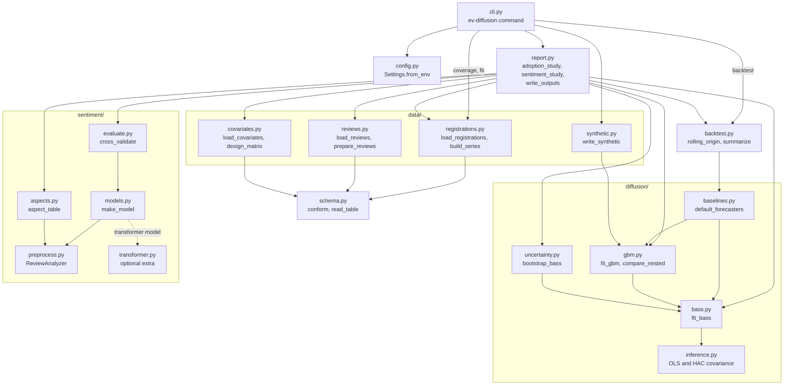

### 2.2 System context

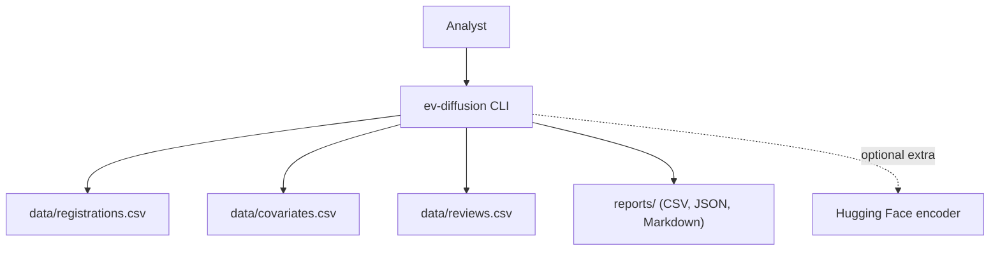

### 2.3 Repository layout

```
ev-diffusion/
├── src/ev_diffusion/
│   ├── config.py            # settings from environment variables
│   ├── schema.py            # column contracts and table reader
│   ├── data/                # registrations, covariates, reviews, synthetic data
│   ├── diffusion/           # bass, gbm, inference, baselines, uncertainty
│   ├── sentiment/           # preprocess, models, evaluate, aspects, transformer
│   ├── backtest.py          # rolling-origin backtest
│   ├── report.py            # full study and report files
│   └── cli.py               # ev-diffusion command
├── tests/                   # 86 pytest tests, synthetic data only
├── data/README.md           # sources, licenses, expected columns
├── docs/ste-style-guide.md  # writing rules and project vocabulary
├── .github/workflows/ci.yml # pytest on Python 3.11
├── pyproject.toml           # package, extras, console script
└── .env.example             # variable names only
```

---

## 3. Design rules

### 3.1 One consistent source for the series
`data/registrations.py` builds the series from the national rows or from a balanced panel of states. It never adds national rows to state rows. The coverage table shows the first year and the last year of each state.

### 3.2 A GBM that the data can identify
`diffusion/gbm.py` puts the covariates into the diffusion clock, as Bass, Krishnan and Jain (1994) define it. The fit refuses a GBM with no covariate, a covariate with a constant log change, or collinear covariates. A multiplier on `m` is not a GBM, because `g * m` is one parameter.

### 3.3 No forecast without a backtest
`backtest.py` fits each model on the years before an origin only. Then it compares the forecast with the actual years. The diffusion models compete with four baselines on the same origins.

### 3.4 Intervals from the data
`diffusion/uncertainty.py` resamples blocks of residuals and fits the Bass model again on each new series. The prediction interval adds resampled residuals to each forecast path. No standard deviation is chosen by hand.

### 3.5 Inference that allows for autocorrelation
`diffusion/inference.py` gives Newey-West (HAC) standard errors and residual diagnostics next to the classic standard errors. The report uses the HAC values.

### 3.6 Labels that keep their meaning
`data/reviews.py` treats a rating of 0 as "not rated" and removes the review from the labelled set. `sentiment/preprocess.py` keeps negation words and marks the words in a negation scope.

### 3.7 Metrics for imbalanced classes
`sentiment/evaluate.py` uses macro-F1, balanced accuracy and the recall of each label. It uses repeated stratified folds and the majority-class baseline on the same folds.

### 3.8 Claims that cite their evidence
`sentiment/aspects.py` gives each aspect a count of mentions, a negative share and a Wilson interval. The report links aspects to the adoption series only when the two markets are the same. Even then, the aspect table is descriptive, not causal.

### 3.9 A light core
The core package needs only NumPy, pandas, SciPy and scikit-learn. The transformer model imports `torch` and `transformers` only when you build it. A test checks that the core import does not load them.

---

## 4. The end-to-end workflow

### 4.1 Full flow

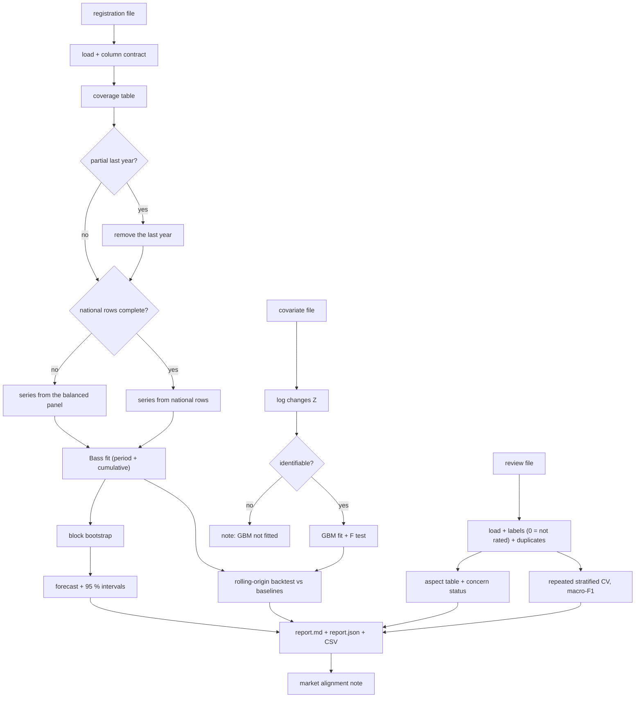

### 4.2 The life cycle of one study

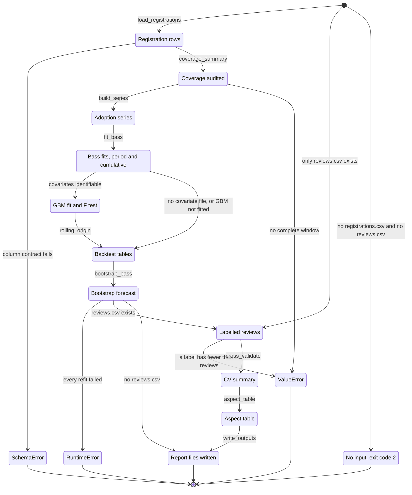

1. Load the registration file and check it against its column contract.
2. Make the coverage table. Remove a partial last year.
3. Build the series from the national rows or from the balanced panel.
4. Fit the Bass model in `period` mode and in `cumulative` mode.
5. If a covariate file exists, check the covariates and fit the GBM.
6. Run the rolling-origin backtest for all models and baselines.
7. Run the block bootstrap and calculate the forecast intervals.
8. Load the reviews, remove unrated reviews and duplicates, and give each review a label.
9. Cross-validate the sentiment models with repeated stratified folds.
10. Make the aspect table and the market alignment note.
11. Write `report.md`, `report.json` and the CSV tables.

### 4.3 Who does which step

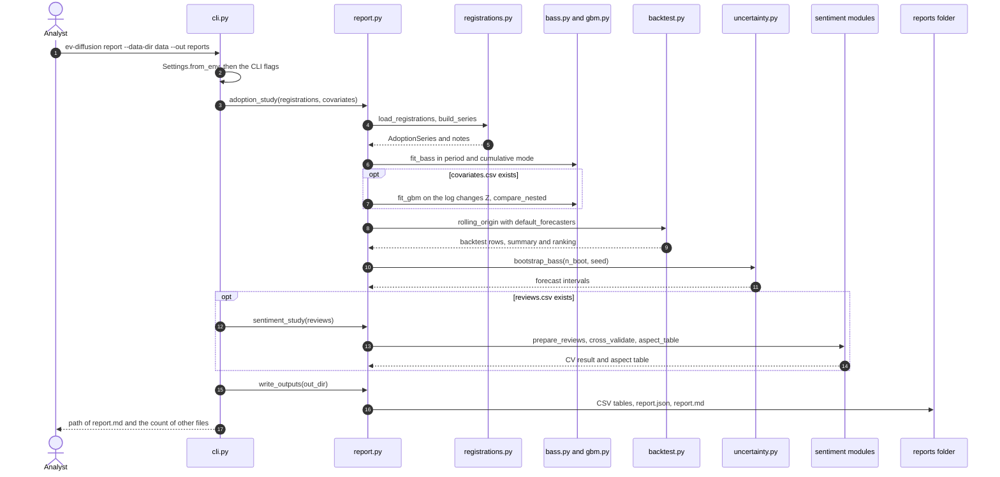

---

## 5. Registration data and the coverage audit

**Purpose.** Make one yearly series that has the same coverage in every year.

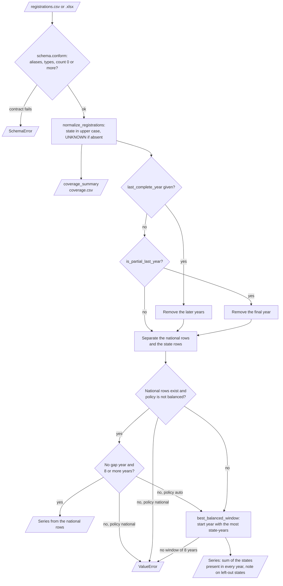

| Input | Output |
|---|---|
| `registrations.csv` or `.xlsx` with `year`, `count`, optional `state` and `make_model` | Coverage summary (`coverage.csv`), the series, notes about each decision |

**Procedure**

1. `schema.conform` maps the header aliases to `year`, `count`, `state` and `make_model`.
2. The contract stops the run if a required column is missing, a value is not numeric or a count is negative.
3. `coverage_summary` gives each state its first year, last year, years present, gap years and total.
4. If you give `--last-complete-year`, the loader removes the later years.
5. If you do not give it, `is_partial_last_year` checks the final year. A partial final year is removed.
6. If the national rows cover every year of at least 8 years, the series comes from the national rows.
7. If not, `best_balanced_window` finds the start year that gives the most state-years. The series is the sum of the states present in every year.

**Rules**

- National rows and state rows are never added together.
- A state that enters the data late is left out of the balanced panel, and a note names it.
- A file without a `state` column gets the note "coverage cannot be checked".

| Policy | Series source | When |
|---|---|---|
| `auto` (default) | National rows, else the balanced panel | National rows exist and have no gap year |
| `national` | National rows only | Stops with an error if the national rows have a gap |
| `balanced` | States present in every year of the best window | Always possible if one state reports for 8 years |

---

## 6. Diffusion models, backtest and bootstrap

**Purpose.** Fit the diffusion models, test their forecasts on unseen years and give intervals from the data.

| Input | Output |
|---|---|
| The series, optional covariate log changes `Z` | Parameter tables (OLS and HAC), diagnostics, backtest tables, forecast with intervals |

**The Bass model.** `F(t) = (1 - exp(-(p+q) t)) / (1 + (q/p) exp(-(p+q) t))`. The adoptions of period `i` are `m (F(i) - F(i-1))`. Period 1 is the first year of the series.

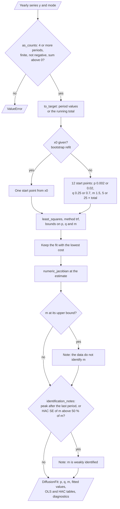

**The GBM.** The clock runs at speed `x(i) = 1 + sum_j beta_j z_j(i)`, where `z_j(i)` is the log change of covariate `j`. Then `X(i) = X(i-1) + x(i)` and `F_GBM(i) = F(X(i))`. If all `beta` values are 0, the GBM is the Bass model.

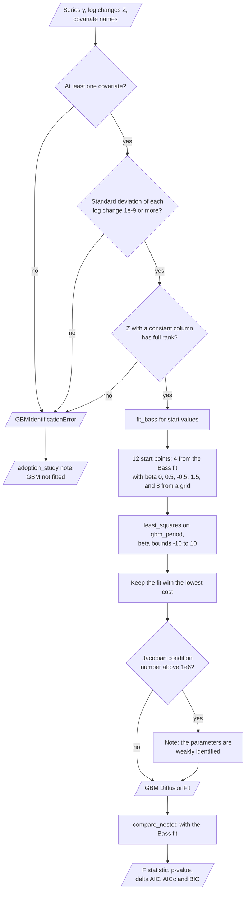

**Procedure**

1. `fit_bass` fits `p`, `q` and `m` by bounded least squares from 12 start points. It keeps the fit with the lowest cost.
2. `m` cannot be smaller than the observed total. If `m` reaches its upper bound, a note says that the data do not identify `m`.
3. If the fitted peak period is after the last observed period, a note says that `m` is weakly identified.
4. `fit_gbm` checks the covariates, fits from Bass-based start points and reports the condition number of the Jacobian.
5. `compare_nested` gives the F test of the GBM against the Bass model and the change in AIC, AICc and BIC.
6. `rolling_origin` fits every model on years `0..o-1` and forecasts the next 1 to 3 years, for each origin `o` from 8.
7. `summarize` gives MAE, RMSE, MAPE and sMAPE for each model and horizon. A failed fit is a result, not a crash.
8. `bootstrap_bass` draws residual blocks of 3 years, fits the Bass model again 200 times and keeps each forecast path.

**Rules**

- The backtest gives the GBM the actual covariates of the forecast years. A real forecast needs a covariate scenario.
- The bootstrap uses relative residuals (`(y - fit) / fit`) by default, because the counts grow by orders of magnitude.
- The report shows the HAC standard errors. The OLS values are available with `--se ols`.

| Forecaster | Rule |
|---|---|
| `naive` | Repeat the last value |
| `drift` | Last value plus the mean change per year |
| `exponential` | Log-linear trend on the last 6 positive values |
| `logistic` | Three-parameter logistic curve on the cumulative total |
| `bass` | Bass fit in `period` mode |
| `bass_cumulative` | Bass fit in `cumulative` mode |
| `gbm` | GBM fit, only with a covariate file |

The diagram shows the rolling-origin backtest. A model never sees a year at or after its origin.

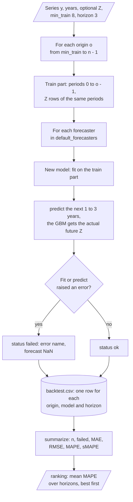

The diagram shows the moving-block residual bootstrap of the Bass fit.

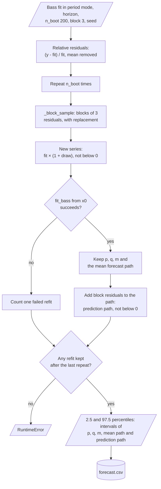

---

## 7. Review sentiment and aspects

**Purpose.** Measure the sentiment of owner reviews with honest metrics, and find the topics that the reviews criticise.

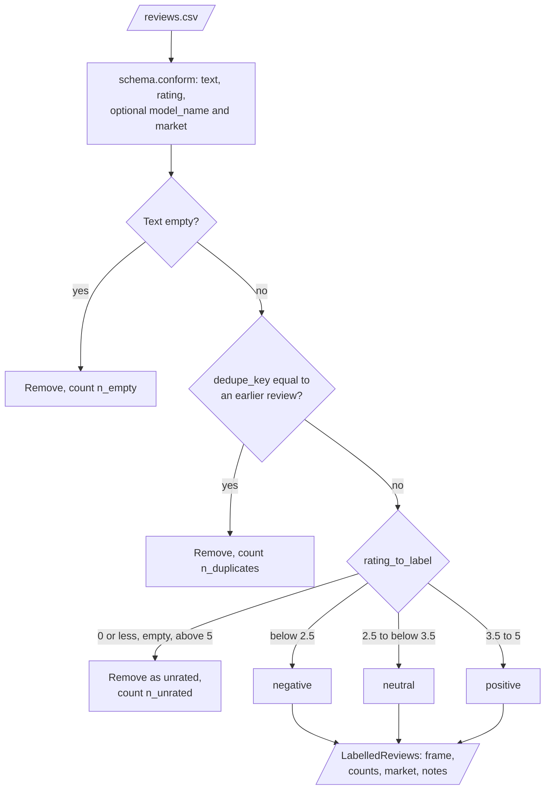

| Input | Output |
|---|---|
| `reviews.csv` with `text`, `rating`, optional `model_name` and `market` | `cv_folds.csv`, `cv_summary.csv`, `aspects.csv`, class counts and notes |

**Procedure**

1. Remove empty reviews and duplicates. Two reviews are duplicates if their lower-case letters and digits are the same.
2. Give each review a label from its rating. Remove unrated reviews.
3. Change each review into tokens. Change "n't" to "not".
4. Mark the words in a negation scope with `NOT_`. Remove the stopwords, but keep the negation words.
5. Make unigram and bigram TF-IDF features inside each training fold.
6. Cross-validate four pipelines with repeated stratified folds: `majority`, `logreg`, `complement_nb` and `linear_svm`.
7. Give the macro-F1, the balanced accuracy, the accuracy and the recall of each label, with corrected 95 % intervals.
8. Compare each model with the majority baseline on the same folds with the corrected paired t test.
9. Cut each review into sentences. Tag the aspects of each sentence and give the sentence a polarity.
10. Count the mentions of each aspect and calculate the negative share with a Wilson 95 % interval.

The diagram shows how `ReviewAnalyzer` changes one review into TF-IDF features (steps 3 to 5).

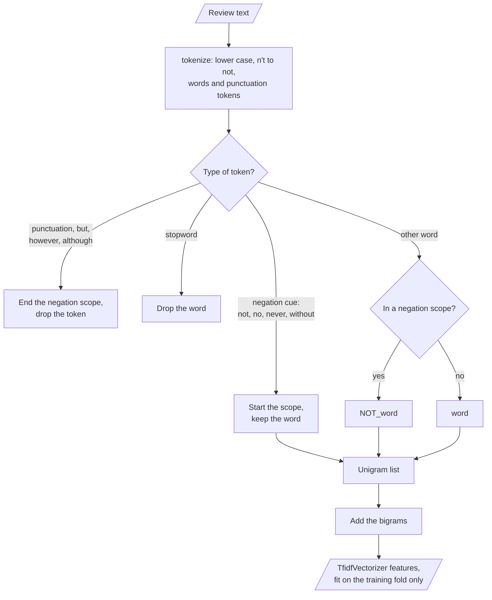

The diagram shows the repeated stratified cross-validation (steps 6 to 8).

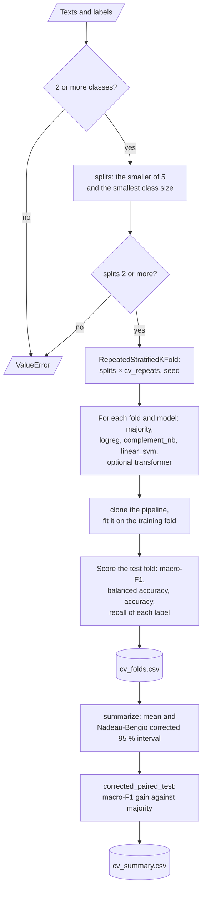

The diagram shows how `aspect_table` finds the concerns (steps 9 and 10).

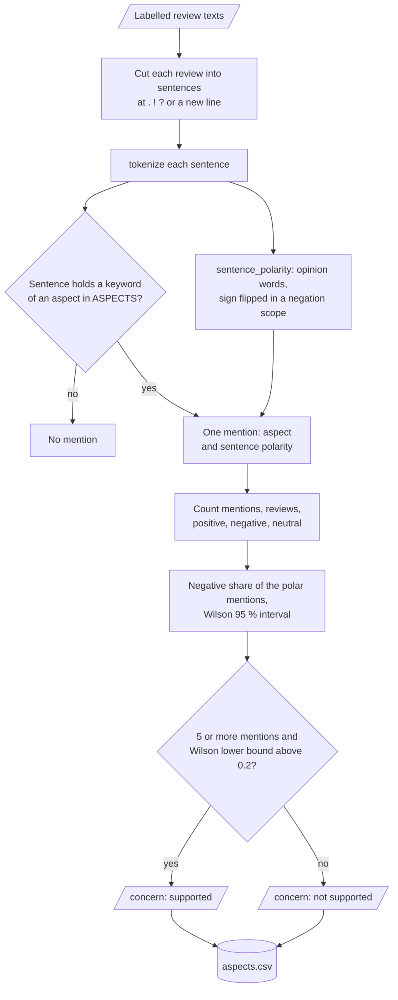

**Rules**

- The number of folds is the smaller of 5 and the size of the smallest label. A label with fewer than 2 reviews stops the run.
- The optional `transformer` model uses a frozen encoder. It is not fine-tuned.
- The aspect lexicon is English and small. Section 11 tells you how to extend it.

| Aspect | Keywords (part) |
|---|---|
| `charging` | charge, charger, station, plug |
| `range` | range, km, mileage, battery |
| `price` | price, cost, expensive, money, value |
| `service` | service, dealer, maintenance, warranty |
| `performance` | speed, pickup, acceleration, power |
| `comfort` | comfort, seat, space, ride, noise |
| `design` | design, look, interior, build, quality |

---

## 8. Decision rules and thresholds

The market alignment rule decides if the report can put the aspect table next to the adoption series. The diagram shows `market_note` in `report.py`.

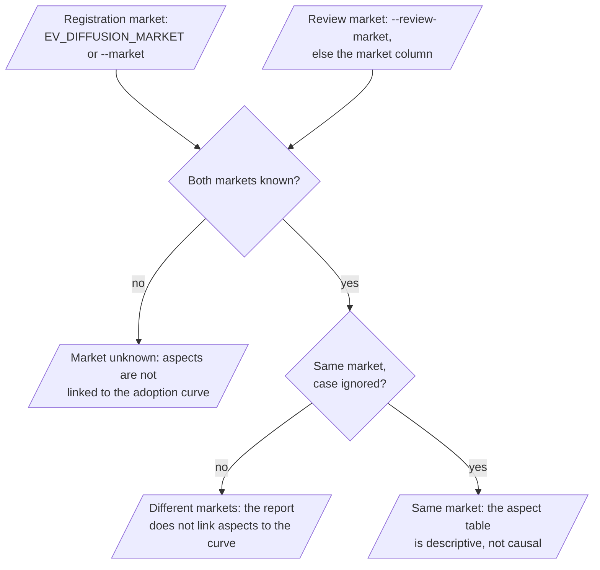

| Rule | Value | Code |
|---|---|---|
| Rating to label | 1 to 2 → `negative`, 3 → `neutral`, 4 to 5 → `positive` | `data/reviews.py` |
| Unrated review | Rating 0, empty, below 0 or above 5 | `data/reviews.py` |
| Partial last year | Final year below 0.6 × the year before, after growth over 3 years | `data/registrations.py` |
| Minimum series length | 8 years for a source, 4 periods for a fit | `data/registrations.py`, `diffusion/bass.py` |
| Bass bounds | `p` 1e-6 to 0.5, `q` 1e-6 to 3, `m` 1 to 1000 × the observed total | `diffusion/bass.py` |
| GBM `beta` bounds | -10 to 10 | `diffusion/gbm.py` |
| Weak identification of `m` | Peak period after the last period, or HAC standard error above 50 % of `m` | `diffusion/bass.py` |
| Weak identification of the GBM | Jacobian condition number above 1e6 | `diffusion/gbm.py` |
| Constant covariate | Standard deviation of the log change below 1e-9 | `diffusion/gbm.py` |
| HAC lags | `floor(4 (n/100)^(2/9))`, at least 1 | `diffusion/inference.py` |
| Backtest | First origin 8, horizon 3 | `backtest.py` |
| Bootstrap | 200 refits, block 3, relative residuals, 2.5 and 97.5 percentiles | `diffusion/uncertainty.py` |
| Cross-validation | Up to 5 folds × 10 repeats, Nadeau-Bengio correction | `sentiment/evaluate.py` |
| Aspect concern `supported` | At least 5 mentions and Wilson lower bound of the negative share above 0.2 | `sentiment/aspects.py` |
| Market alignment | Aspects are linked to the series only if both markets are the same | `report.py` |

---

## 9. Data and file map

| Path | Committed? | Contents |
|---|---|---|
| `data/README.md` | Yes | Sources, licenses, expected columns, download steps |
| `data/registrations.csv` | No (git ignores it) | Registration rows |
| `data/covariates.csv` | No (git ignores it) | Positive yearly covariates |
| `data/reviews.csv` | No (git ignores it) | Owner reviews with ratings |
| `reports/` | No (git ignores it) | `report.md`, `report.json`, `coverage.csv`, `backtest.csv`, `backtest_summary.csv`, `forecast.csv`, `cv_folds.csv`, `cv_summary.csv`, `aspects.csv` |
| `reports/demo/synthetic_data/` | No (git ignores it) | Synthetic files from `ev-diffusion demo` |
| `.env` | No (git ignores it) | Local settings |
| `.env.example` | Yes | Variable names only |

---

## 10. How to run ev-diffusion

### 10.1 Prerequisites

| Need | For |
|---|---|
| Python 3.11+ | All components |
| `openpyxl` (extra `excel`) | Registration files in `.xlsx` format |
| `torch` and `transformers` (extra `transformer`) | The optional `transformer` sentiment model |
| Network access | Only the first run of the `transformer` model, to download the encoder |

### 10.2 Installation

```bash
git clone https://github.com/KrishnaAnnavaram/ev-diffusion.git
cd ev-diffusion
python -m venv .venv
. .venv/bin/activate            # Windows: .venv\Scripts\activate
pip install -e ".[dev]"
pip install -e ".[excel]"       # optional: .xlsx input
pip install -e ".[transformer]" # optional: transformer sentiment model
```

### 10.3 Run ev-diffusion

Run the offline demo first. It uses synthetic data only.

```bash
ev-diffusion demo --out reports/demo
```

Run each step on your own data. The files are in `data/` (see [`data/README.md`](data/README.md)).

```bash
ev-diffusion synth --out data                                   # synthetic files with the real columns
ev-diffusion coverage --registrations data/registrations.csv    # coverage table and the chosen series
ev-diffusion fit --registrations data/registrations.csv --covariates data/covariates.csv
ev-diffusion fit --registrations data/registrations.csv --mode cumulative --se ols
ev-diffusion backtest --registrations data/registrations.csv --covariates data/covariates.csv --horizon 3 --out reports/backtest.csv
ev-diffusion forecast --registrations data/registrations.csv --horizon 5 --n-boot 500
ev-diffusion sentiment --reviews data/reviews.csv --review-market IN --cv-repeats 10
ev-diffusion sentiment --reviews data/reviews.csv --models majority logreg transformer
ev-diffusion aspects --reviews data/reviews.csv --min-mentions 5
ev-diffusion report --data-dir data --out reports --review-market IN
pytest -q
```

| Command | What it does |
|---|---|
| `synth` | Writes `registrations.csv`, `covariates.csv` and `reviews.csv` with synthetic data |
| `coverage` | Prints the coverage summary, the chosen series and the notes |
| `fit` | Fits the Bass model, and the GBM with `--covariates` |
| `backtest` | Rolling-origin backtest of all forecasters |
| `forecast` | Bass forecast with bootstrap intervals |
| `sentiment` | Repeated stratified cross-validation of the sentiment models |
| `aspects` | The aspect table |
| `report` | The full study from a data folder |
| `demo` | Synthetic data plus the full study |

The diagram shows the order of the commands and the files that connect them.

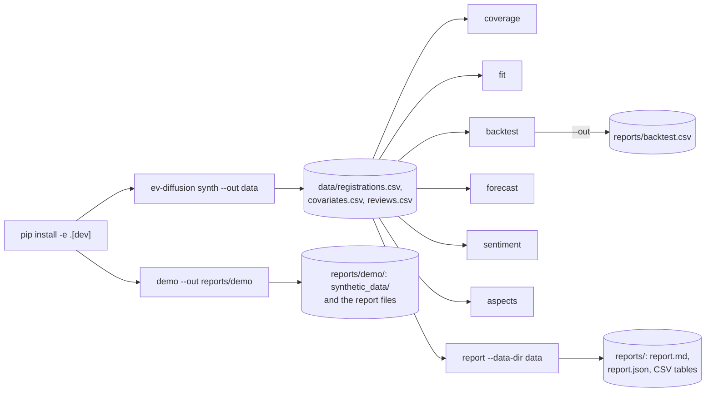

### 10.4 Environment variables

| Variable | Used by | Meaning |
|---|---|---|
| `EV_DIFFUSION_DATA_DIR` | `report` | Data folder, default `data` |
| `EV_DIFFUSION_OUTPUT_DIR` | `report` | Output folder, default `reports` |
| `EV_DIFFUSION_SEED` | bootstrap, cross-validation, synthetic data of `demo` | Random seed, default `42`. The `synth` command uses only `--seed` (default `42`) |
| `EV_DIFFUSION_N_BOOT` | bootstrap | Number of refits, default `200`, minimum `20` |
| `EV_DIFFUSION_CV_REPEATS` | cross-validation | Repeats of the stratified folds, default `10` |
| `EV_DIFFUSION_LAST_COMPLETE_YEAR` | coverage audit | Last complete year. Empty means the partial-year rule |
| `EV_DIFFUSION_MARKET` | coverage audit, report | Market of the registration data, default `US` |
| `EV_DIFFUSION_TRANSFORMER_MODEL` | `transformer` model | Hugging Face model name, default `distilbert-base-uncased` |

CLI flags override these values. ev-diffusion needs no credentials. The CLI does not read a `.env` file. Set the variables in your shell. Git ignores a local `.env` file.

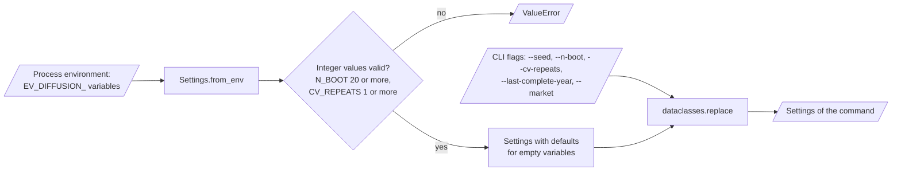

---

## 11. How to extend ev-diffusion

| You want to… | Do this | Code change? |
|---|---|---|
| Use a new registration source | Map its headers to `year`, `count`, `state` in a CSV, or add an alias in `REGISTRATION_COLUMNS` | No / Small |
| Add a GBM covariate | Add a positive column to `covariates.csv` | No |
| Add a forecaster | Subclass `Forecaster` and add it to `default_forecasters` | Small |
| Add a sentiment model | Add a pipeline to `make_model` and its name to `MODEL_NAMES` | Small |
| Add an aspect or keywords | Edit `ASPECTS` in `sentiment/aspects.py` | Small |
| Change the concern rule | Use `aspect_table(min_mentions=..., min_negative_share=...)` | No |
| Add a Bayesian Bass model | Add a module in `diffusion/` with an optional extra, and compare it in the backtest | Yes |

---

## 12. Validation results

All results below come from `pytest` and from `ev-diffusion demo` with the default seed `42`. The demo results use **synthetic data**. They are not results on real registrations or real reviews.

| Validation | Result | Command |
|---|---|---|
| Unit tests | **86 passed**, 0 skipped | `pytest -q` |
| Partial-year rule (synthetic) | 2024 removed, series 2010-2023 from national rows | `ev-diffusion demo` |
| Bass fit (synthetic) | `p` = 0.00155, `q` = 0.400, `m` = 3.41 million (HAC SE 0.39 million) | `ev-diffusion demo` |
| GBM fit (synthetic, true `q` = 0.33, true betas 0.9 and 0.6) | `q` = 0.347, `beta_charging_ports` = 0.63, `beta_incentive_index` = 0.69 | `ev-diffusion demo` |
| GBM against Bass (synthetic) | F = 162.0, p = 8.8e-08, ΔAICc = -41.5 | `ev-diffusion demo` |
| Backtest mean MAPE, horizons 1-3 (synthetic) | `gbm` 15.7 %, `drift` 25.0 %, `bass_cumulative` 34.2 %, `exponential` 34.7 %, `naive` 35.3 %, `logistic` 39.4 %, `bass` 42.8 % | `ev-diffusion demo` |
| Bootstrap (synthetic) | 200 refits, 0 failed. 2024 prediction interval 221,860 to 529,859 | `ev-diffusion demo` |
| Labelled reviews (synthetic) | 432 in, 27 unrated, 38 duplicates, 367 labelled (63 / 32 / 272) | `ev-diffusion demo` |
| Macro-F1, 5 folds × 10 repeats (synthetic) | `majority` 0.284, `complement_nb` 0.643, `linear_svm` 0.755, `logreg` 0.756 (corrected 95 % interval 0.675 to 0.838) | `ev-diffusion demo` |
| Aspect concerns (synthetic) | `supported`: service, charging, price. `not supported`: range, comfort, performance, design | `ev-diffusion demo` |

The tests show that each design rule works on controlled data. The GBM tests get the true parameters back from clean synthetic data. The demo shows a known effect: the plain Bass model has a higher backtest error than the drift baseline on this series. Thus a Bass forecast without a backtest gives no evidence of quality. The numbers do not tell how the models perform on real EV data. The prototype had no out-of-sample result to compare with.

---

## 13. Known problems

Read these problems before you use ev-diffusion for a decision.

| # | Area | Problem | Impact and action |
|---|---|---|---|
| 1 | Validation | CI runs on synthetic data only. Results on the real registration and review data are not reproduced here | Run `ev-diffusion report` on the real files and read the backtest first |
| 2 | Data | The real review corpus (129 reviews from an Indian car portal) is small and has a different market from US registrations | The market note blocks a joint claim. Collect reviews from the same market |
| 3 | Diffusion | Period 1 is the first year of the series. Adoptions before that year are not modelled | If the source starts late, `p` is too high. Start the series at the first EV year |
| 4 | Diffusion | Before the peak period, the data identify `m` weakly | Read the identification notes and the bootstrap interval of `m` |
| 5 | GBM | The backtest gives the GBM the actual future covariates | The GBM backtest error is optimistic. Use covariate scenarios for real forecasts |
| 6 | Bootstrap | The block bootstrap assumes that the relative residuals have a stable distribution | Intervals can be too narrow after a structural break |
| 7 | Coverage | The partial-year rule is a heuristic | Give `--last-complete-year` for real data |
| 8 | Sentiment | The aspect lexicon and the opinion lexicon are small and English only | Extend `ASPECTS`, `POSITIVE_WORDS` and `NEGATIVE_WORDS` for a new corpus |
| 9 | Sentiment | The `transformer` model is not tested in CI, and it needs a model download | Test it locally before you report its scores |
| 10 | Scope | No Bayesian Bass model yet | The bootstrap is the only source of parameter intervals besides the HAC values |

---

## 14. Key points

1. **The series has one consistent source.** National rows and state rows are never added together, and late states are left out of the balanced panel.
2. **The GBM is identified or it is not fitted.** The fit refuses covariates that only rescale `p` and `q`.
3. **Every forecaster competes in the same backtest.** On the synthetic series the plain Bass model loses to the drift baseline.
4. **Intervals come from the residuals.** The block bootstrap refits the model 200 times.
5. **Unrated reviews are not negative reviews.** A rating of 0 removes the review from the labelled set.
6. **Negations stay in the text.** "not good" and "good" are different features.
7. **Macro-F1 is the main metric.** Each model is compared with the majority baseline on the same folds.
8. **A concern needs evidence.** The aspect table gives counts, a negative share and a Wilson interval.

---

## 15. Glossary

| Term | Meaning |
|---|---|
| **Adoption** | The new registrations in one period |
| **Aspect** | A topic of a review: charging, range, price, service, performance, comfort or design |
| **Backtest** | The rolling-origin test of forecasts on years that the fit did not see |
| **Balanced panel** | The states that have rows in every year of the window |
| **Baseline** | A simple forecaster: `naive`, `drift`, `exponential` or `logistic` |
| **Bass model** | The diffusion model with the parameters `p`, `q` and `m` |
| **Block** | A run of neighbouring residuals that the bootstrap copies as one unit |
| **Bootstrap** | The moving-block residual bootstrap of the Bass fit |
| **Concern** | An aspect with enough mentions and a clear negative share |
| **Corrected interval** | The Nadeau-Bengio corrected 95 % interval of the fold scores |
| **Covariate** | A positive yearly value that can change the diffusion speed |
| **Coverage** | The years in which each state has rows in the registration file |
| **Duplicate** | A review with the same text as an earlier review after normalization |
| **GBM** | The Generalized Bass Model with one `beta` for each covariate |
| **HAC standard error** | The Newey-West standard error that allows for autocorrelated residuals |
| **Horizon** | The number of years after the origin that a forecast covers |
| **Label** | The sentiment class of a review: `negative`, `neutral` or `positive` |
| **Log change** | `ln(c(t) / c(t-1))` of a covariate |
| **`m`** | The market size: the number of adoptions at the end of the diffusion |
| **Macro-F1** | The mean of the F1 values of the three labels |
| **Market** | The country or region of the data |
| **Mention** | One sentence that holds a keyword of an aspect |
| **Negation scope** | The words after a negation word, up to the next punctuation mark or "but" |
| **Origin** | The last year that a backtest fit can see |
| **`p`** | The innovation coefficient of the Bass model |
| **Partial year** | A final year that the source did not finish |
| **Peak period** | The period with the highest adoption rate of a fitted Bass model |
| **Prediction interval** | The 95 % range of future adoptions, with the residual noise added |
| **`q`** | The imitation coefficient of the Bass model |
| **Series** | The yearly adoptions that the models use, from one consistent source |
| **Synthetic data** | The generated files of `ev-diffusion synth`. They are not real data |
| **Unrated review** | A review with the rating 0, an empty rating or a rating outside 1 to 5 |

---

## 16. License

[MIT](LICENSE) © 2026 Krishna Annavaram
